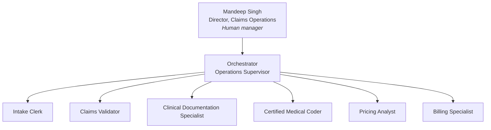

# Agent-Managed Claims Platform

A prototype medical claims pipeline run entirely by AI agents, built by learn4free to show what it means to be a **manager of agents**.

The platform is run like a department. Each agent is an employee with a job title, a job description, goals, KPIs, a skills profile, a performance review and a development plan. The human manager leads the team with the same cadence used for people: daily escalations, weekly 1:1s, quarterly goals and an annual review. People move up from routine checks to judgment and oversight.

> **Synthetic data only.** No real patients, providers, insurers or billing rules are used anywhere in this project.

## The team



| Agent | Job title | Job |
| --- | --- | --- |
| Intake Agent | Intake Clerk | Standardize incoming records |
| Validation Agent | Claims Validator | Confirm all claim-required fields exist |
| Clinical Review Agent | Clinical Documentation Specialist | Extract diagnoses and procedures from the doctor's note |
| Coding Agent | Certified Medical Coder | Assign ICD-10 and CPT codes |
| Pricing Agent | Pricing Analyst | Price each procedure from the internal data dictionary |
| Submission Agent | Billing Specialist | Assemble the claim and send it to the mock insurer |

## How it is built: AI-DLC

The project follows the AI-Driven Development Lifecycle. AI proposes the work at each stage; the manager approves at each gate. Every stage's artifact lives in [`aidlc/`](aidlc/).

| Phase | Stage | Status | Artifact |
| --- | --- | --- | --- |
| Inception | Intake | Approved 2026-11-24 | [01-intake-intent.md](aidlc/01-intake-intent.md) |
| Inception | Requirements | Approved 2026-11-24 | [02-requirements.md](aidlc/02-requirements.md) |
| Construction | Dev: design and UX | Approved 2026-11-24 | [03-design.md](aidlc/03-design.md), [ux/](ux/) |
| Construction | Dev: Bolt 1, synthetic data | Done 2026-11-24 | [04-bolt-1-data-generator.md](aidlc/04-bolt-1-data-generator.md) |
| Construction | Dev: Bolts 2 to 7 | Next | |
| Construction | Build | Not started | |
| Construction | Test | Not started | |
| Operations | Deploy | Not started | |
| Operations | Maintenance | Not started | |

## Quick start

```
python -m data.generate --count 200 --seed 42 --out data/out
pip install -r requirements-dev.txt
pytest
```

## Repository layout

```
aidlc/        Approved artifacts for each AI-DLC stage
data/         Synthetic data: code set, fee schedule, scenarios, generator
tests/        pytest suites
ux/           Dashboard mockup, CSS theme and design notes
```
