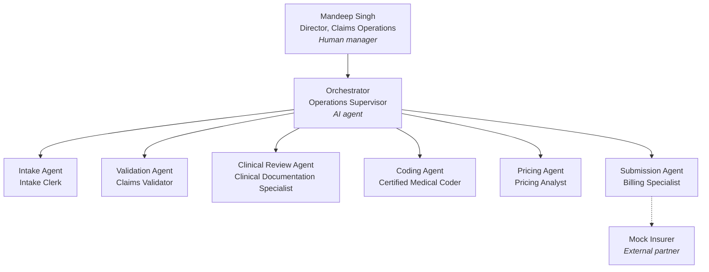

# Stage 3: Design (Dev, part 1)

**Phase:** Construction
**Status:** Proposed, awaiting manager approval

The platform is run like a department: a human manager leads a team of AI agents organized as an org chart, and manages them with the same cadence used for people. Technically, it is a Python backend where each agent is a Claude-powered employee with a job description, typed inputs and outputs, and an escalation rule, plus a React dashboard for the manager. No code is written until this design is approved.

## The org chart

Every agent is an employee on the team. The human manager owns the department, the orchestrator acts as the team's supervisor, and six specialists each do one job.



### Team roster

| Agent | Job title | Human role it represents | Reports to | Seniority (model) |
| --- | --- | --- | --- | --- |
| Orchestrator | Operations Supervisor | Team lead who assigns and tracks work | Manager | Rule-based, no model |
| Intake Agent | Intake Clerk | Front-desk records clerk | Orchestrator | Junior (`claude-haiku-5-5`) |
| Validation Agent | Claims Validator | Claims examiner checking completeness | Orchestrator | Junior (`claude-haiku-5-5`) |
| Clinical Review Agent | Clinical Documentation Specialist | Nurse reviewer reading physician notes | Orchestrator | Senior (`claude-sonnet-5-5`) |
| Coding Agent | Certified Medical Coder | Certified professional coder | Orchestrator | Senior (`claude-sonnet-5-5`) |
| Pricing Agent | Pricing Analyst | Analyst applying the fee schedule | Orchestrator | Junior (`claude-haiku-5-5`) |
| Submission Agent | Billing Specialist | Billing specialist who files claims | Orchestrator | Junior (`claude-haiku-5-5`) |

Seniority maps to the model: simple, rule-following jobs get a faster, cheaper model; judgment-heavy jobs get a stronger one, the way a team pairs junior staff with routine work and senior staff with complex cases. Model names are configurable ([model docs](https://docs.claude.com/en/docs/about-claude/models/overview)).

### The employee lifecycle, for agents

| People management | Agent management in this platform |
| --- | --- |
| Hiring | Deploying a new agent, with a version number as its employee ID |
| Onboarding | Its system prompt (job description), tools and access rights |
| Training | Updating its prompt, examples or data dictionary |
| Daily check-ins | The escalation inbox: questions the agent brings to the manager |
| Weekly 1:1 | Reviewing each agent's KPI trend for the week |
| Quarterly goals | KPI targets set and adjusted by the manager |
| Annual review | The scorecard: goals versus actuals, rating, skills, development plan |
| Promotion | More autonomy: a lower escalation threshold, fewer approvals needed |
| Performance improvement plan | Tighter guardrails, more escalation, closer review |
| Replacement | Retiring an agent version and deploying a better one |

### The manager's cadence

| Cadence | What the manager does | Where in the dashboard |
| --- | --- | --- |
| Daily | Clears the escalation inbox | Escalation inbox |
| Weekly | Checks each agent's KPIs and trend, like a 1:1 | Agent profile |
| Quarterly | Reviews goals and adjusts targets | Goals settings |
| Yearly | Signs off each agent's annual review and development plan | Scorecards |

The manager stays accountable for results. Agents do the work; the manager owns the outcome, as with any human team.

## Architecture

```
                 +----------------------------+
                 | Manager dashboard (React)  |
                 | org chart | inbox | profiles | team view
                 +-------------+--------------+
                               | REST API
                 +-------------v--------------+
                 |    API server (FastAPI)    |
                 +-------------+--------------+
                               |
                 +-------------v--------------+
                 | Orchestrator (supervisor)  |---- escalations ----> Manager inbox
                 +-------------+--------------+
                               |
  Intake -> Validation -> Clinical review -> Medical coding -> Pricing -> Submission
                               |                                            |
                 +-------------v---------------+                 +------------v-----------+
                 | SQLite: claims, decisions,  |                 |  Mock insurer service  |
                 | escalations, scorecards     |                 +------------------------+
                 +-----------------------------+

  Synthetic data generator --> records + hidden answer key --> Test stage and scorecards
```

## Manager dashboard

The dashboard opens on the **org chart**. Each agent appears as an employee card showing its title, current status against goals (green, amber, red) and open escalations. Clicking a card opens that agent's **employee profile**.

| View | What it shows |
| --- | --- |
| Org chart (home) | The team, each agent's health against goals, claims in flight |
| Employee profile | Job description, goals, KPIs, false positive and false negative rates, skills by specialty, review history, development plan |
| Escalation inbox | Items waiting for the manager, with the agent's reasoning and approve, correct or reject actions |
| Team view | Agent team versus the human baseline: headcount equivalent, time, cost, error rate |

## Tech stack

| Layer | Choice | Why |
| --- | --- | --- |
| Language | Python 3.12 | Best AI and data tooling, easy for others to read |
| Agents | Anthropic Python SDK, one class per agent | Each agent's system prompt is its job description, readable by non-engineers |
| Structured output | Pydantic schemas for every handoff | Handoffs are contracts; bad output is caught, not passed on |
| API | FastAPI | Simple, typed, auto-generated API docs |
| Storage | SQLite | Zero setup; enough for a prototype |
| Dashboard | React + Vite + Tailwind | Fast to build, easy to demo |
| Tests | pytest | Standard |
| Packaging | Docker Compose | One command to run everything |

## Agent design

Every agent follows the same contract, mirroring an employee role:

| Employee element | Implementation |
| --- | --- |
| Job description | System prompt in `agents/prompts/<agent>.md` |
| Employee profile | `agents/roster.yaml`: title, human role, reports to, seniority, version |
| Inputs and deliverables | Pydantic models in `agents/schemas.py` |
| When to ask the manager | Escalation rule checked after each decision (e.g. coding confidence below 0.85) |
| Work log | Every decision saved with reasoning, model, latency and cost |
| Tools and access | Read-only lookups only: code set for coding, fee schedule for pricing |

## Two run modes

- **Live mode:** agents call Claude. Used for the real demo and the Test stage.
- **Simulated mode:** agents return scripted results with tunable error rates, no API key needed. Used for unit tests, offline demos, and showing how an employee profile reacts when an agent underperforms.

## Data model

| Table | Holds |
| --- | --- |
| `claims` | Each claim and its current stage and status |
| `decisions` | One row per agent decision: input, output, reasoning, confidence, latency, cost |
| `escalations` | Items sent to the manager, and the manager's decision |
| `answer_key` | Correct validity, codes and price per claim; never visible to agents |
| `code_set` | About 40 ICD-10 and 40 CPT codes in use |
| `fee_schedule` | Internal price per CPT code, plus modifier rules |
| `insurer_responses` | Accept or deny, with reason and the agent responsible |
| `goals` | KPI targets per agent, editable by the manager |
| `reviews` | Signed-off reviews per agent and period, with rating and development plan |

Scorecards are computed from `decisions`, `escalations` and `answer_key`, so they always reflect real results.

## Repository layout

```
aidlc/            Approved AI-DLC artifacts
agents/           Roster, six worker agents, prompts, schemas
orchestrator/     Supervisor: pipeline runner and escalation routing
insurer/          Mock insurer rules
data/             Synthetic data generator, code set, fee schedule
scoring/          KPI, scorecard and review calculations
api/              FastAPI server
dashboard/        React manager dashboard
tests/            pytest suites
```

## Build plan (bolts)

AI-DLC works in short cycles called bolts. Each ends with a commit and a working, testable piece.

1. Synthetic data generator, code set, fee schedule and answer key
2. Agent framework and team roster, plus intake and validation agents
3. Clinical review and medical coding agents
4. Pricing and submission agents, plus the mock insurer
5. Orchestrator and escalation inbox
6. Scoring engine, scorecards and reviews
7. Manager dashboard with org chart and employee profiles

## Risks

| Risk | Mitigation |
| --- | --- |
| Model output drifts from schema | Pydantic validation with one automatic retry, then escalate |
| API cost during repeated tests | Simulated mode for most tests; live runs capped at 200 claims |
| Synthetic notes too easy, inflating accuracy | Generator includes vague, contradictory and unusual notes at about 30% |
| Viewers mistake it for a real billing system | "Synthetic data, prototype only" banner on every dashboard page |

## Decisions for the manager

- [ ] Approve the org chart, job titles and management cadence
- [ ] Approve the tech stack (Python, FastAPI, SQLite, React)
- [ ] Approve per-agent seniority (model defaults)
- [ ] Approve the two run modes
- [ ] Approve the seven-bolt build plan
