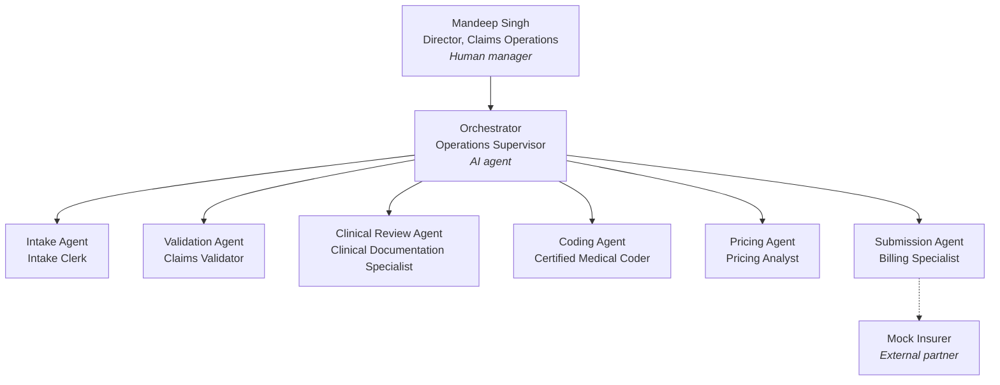

# Stage 3: Design (Dev, part 1)

**Phase:** Construction
**Status:** Approved by the manager on 2026-11-24

The platform is run like a department: a human manager leads a team of AI agents organized as an org chart, and manages them with the same cadence used for people. Technically, it is a Python backend where each agent is a Claude-powered employee with a job description, typed inputs and outputs, and an escalation rule, plus a React dashboard. The approved dashboard design is in [`ux/`](../ux/).

## The org chart



### Team roster

| Agent | Job title | Comparable human role | Reports to | Seniority (model) |
| --- | --- | --- | --- | --- |
| Orchestrator | Operations Supervisor | Team lead who assigns and tracks work | Manager | Rule-based, no model |
| Intake Agent | Intake Clerk | Front-desk records clerk | Orchestrator | Junior (`claude-haiku-5-5`) |
| Validation Agent | Claims Validator | Claims examiner checking completeness | Orchestrator | Junior (`claude-haiku-5-5`) |
| Clinical Review Agent | Clinical Documentation Specialist | Nurse reviewer reading physician notes | Orchestrator | Senior (`claude-sonnet-5-5`) |
| Coding Agent | Certified Medical Coder | Certified professional coder | Orchestrator | Senior (`claude-sonnet-5-5`) |
| Pricing Agent | Pricing Analyst | Analyst applying the fee schedule | Orchestrator | Junior (`claude-haiku-5-5`) |
| Submission Agent | Billing Specialist | Billing specialist who files claims | Orchestrator | Junior (`claude-haiku-5-5`) |

Seniority maps to the model: simple, rule-following jobs get a faster, cheaper model; judgment-heavy jobs get a stronger one. Model names are configurable ([model docs](https://docs.claude.com/en/docs/about-claude/models/overview)). Job titles describe each agent's role; they are an analogy for managing the work, not a claim that agents replace people.

### The employee lifecycle, for agents

| People management | Agent management in this platform |
| --- | --- |
| Hiring | Deploying a new agent, with a version number as its employee ID |
| Onboarding | Its system prompt (job description), tools and access rights |
| Training | Updating its prompt, examples or data dictionary |
| Daily check-ins | The escalation inbox: questions the agent brings to the manager |
| Weekly 1:1 | The agent's own written update, KPI trend, blockers and action items |
| Quarterly goals | KPI targets set and adjusted by the manager |
| Talent review | The 9-box: performance vs. potential, with a recommended action |
| Annual review | The scorecard: goals versus actuals, rating, skills, development plan |
| Promotion | More autonomy: a lower escalation threshold, fewer approvals needed |
| Improvement plan | Time-boxed checkpoints, extra support, tighter guardrails |
| Retiring a version | Replacing an agent version with a better one |

### The manager's cadence

| Cadence | What the manager does | Where in the dashboard |
| --- | --- | --- |
| Daily | Clears the escalation inbox | Escalation inbox |
| Weekly | Runs a 1:1 with each agent | 1:1s, Employee profile |
| Quarterly | Reviews plans vs. actuals and the 9-box; adjusts goals | Plans vs. actuals, 9-box |
| Yearly | Signs off each agent's annual review and development plan | Employee profile |

The manager stays accountable for results. Agents do the work; the manager owns the outcome.

## Architecture

```
                 +----------------------------+
                 | Manager dashboard (React)  |
                 | personas: executive, manager, engineering
                 +-------------+--------------+
                               | REST API
                 +-------------v--------------+
                 |    API server (FastAPI)    |
                 +-------------+--------------+
                               |
                 +-------------v--------------+
                 | Orchestrator (supervisor)  |---- escalations ----> Manager inbox
                 +-------------+--------------+---- deviations ----> GitHub issues
                               |
  Intake -> Validation -> Clinical review -> Medical coding -> Pricing -> Submission
                               |                                            |
                 +-------------v---------------+                 +------------v-----------+
                 | SQLite: claims, decisions,  |                 |  Mock insurer service  |
                 | escalations, reviews        |                 +------------------------+
                 +-----------------------------+

  Synthetic data generator --> records + hidden answer key --> Test stage and scorecards
```

## Manager dashboard

The approved mockup is [`ux/dashboard-mockup.html`](../ux/dashboard-mockup.html), styled by [`ux/theme.css`](../ux/theme.css). Screens and personas are described in [`ux/README.md`](../ux/README.md).

| Persona | Lands on | Views |
| --- | --- | --- |
| Executive | Executive summary | Executive summary, plans vs. actuals, 9-box, fix roadmap, before and after |
| Claims manager | Org chart | All views |
| Engineering lead | Fix roadmap | Fix roadmap, employee profile, plans vs. actuals, escalation inbox |

## Tech stack

| Layer | Choice | Why |
| --- | --- | --- |
| Language | Python 3.12 | Best AI and data tooling, easy for others to read |
| Agents | Anthropic Python SDK, one class per agent | Each agent's system prompt is its job description, readable by non-engineers |
| Structured output | Pydantic schemas for every handoff | Handoffs are contracts; bad output is caught, not passed on |
| API | FastAPI | Simple, typed, auto-generated API docs |
| Storage | SQLite | Zero setup; enough for a prototype |
| Dashboard | React + Vite, styled with `ux/theme.css` | Matches the approved mockup |
| Issue tracking | GitHub issues via the GitHub API | Target deviations tracked where engineers already work |
| Tests | pytest | Standard |
| Packaging | Docker Compose | One command to run everything |

## Agent design

| Employee element | Implementation |
| --- | --- |
| Job description | System prompt in `agents/prompts/<agent>.md` |
| Employee profile | `agents/roster.yaml`: title, comparable role, reports to, seniority, version |
| Inputs and deliverables | Pydantic models in `agents/schemas.py` |
| When to ask the manager | Escalation rule checked after each decision (e.g. coding confidence below 0.85) |
| Work log | Every decision saved with reasoning, model, latency and cost |
| Tools and access | Read-only lookups only: code set for coding, fee schedule for pricing |

## Two run modes

- **Live mode:** agents call Claude. Used for the real demo and the Test stage.
- **Simulated mode:** agents return scripted results with tunable error rates, no API key needed. Used for unit tests, offline demos, and showing how a profile reacts when an agent underperforms.

## Data model

| Table | Holds |
| --- | --- |
| `claims` | Each claim and its current stage and status |
| `decisions` | One row per agent decision: input, output, reasoning, confidence, latency, cost |
| `escalations` | Items sent to the manager, and the manager's decision |
| `answer_key` | Correct validity, codes and price per claim; never visible to agents |
| `code_set` | 40 ICD-10 and 40 CPT codes in use |
| `fee_schedule` | Internal price per CPT code, plus modifier rules |
| `insurer_responses` | Accept or deny, with reason and the agent responsible |
| `goals` | KPI targets per agent, editable by the manager |
| `one_on_ones` | Weekly 1:1 records: agent update, notes, action items |
| `improvement_plans` | Plan, checkpoints, guardrails, outcome |
| `deviation_issues` | Link between a missed target and its GitHub issue |
| `reviews` | Signed-off reviews per agent and period, with rating and development plan |

## Repository layout

```
aidlc/            Approved AI-DLC artifacts
agents/           Roster, six worker agents, prompts, schemas
orchestrator/     Supervisor: pipeline runner, escalation routing, GitHub issues
insurer/          Mock insurer rules
data/             Synthetic data generator, code set, fee schedule
scoring/          KPI, scorecard, 9-box and review calculations
api/              FastAPI server
dashboard/        React manager dashboard
ux/               Approved mockup, CSS theme, design notes
tests/            pytest suites
```

## Build plan (bolts)

1. Synthetic data generator, code set, fee schedule and answer key (done)
2. Agent framework and team roster, plus intake and validation agents
3. Clinical review and medical coding agents
4. Pricing and submission agents, plus the mock insurer
5. Orchestrator, escalation inbox and automatic GitHub issues
6. Scoring engine: scorecards, plans vs. actuals, 9-box, reviews
7. Manager dashboard with personas, matching the approved mockup

## Risks

| Risk | Mitigation |
| --- | --- |
| Model output drifts from schema | Pydantic validation with one automatic retry, then escalate |
| API cost during repeated tests | Simulated mode for most tests; live runs capped at 200 claims |
| Synthetic notes too easy, inflating accuracy | Generator includes vague, contradictory and unusual notes at about 30% |
| Viewers mistake it for a real billing system | "Synthetic data, prototype only" banner and AI illustration disclaimers on every page |

## Decisions for the manager (approved 2026-11-24)

- [x] Approve the org chart, job titles and management cadence
- [x] Approve the tech stack (Python, FastAPI, SQLite, React)
- [x] Approve per-agent seniority (model defaults)
- [x] Approve the two run modes
- [x] Approve the seven-bolt build plan
